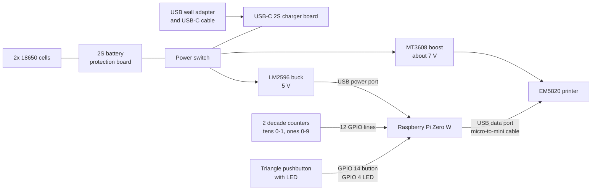
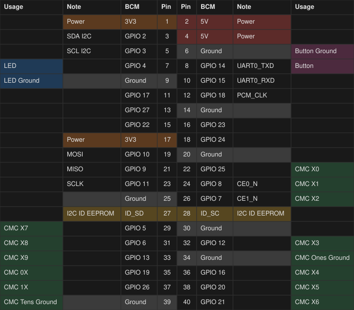

# Hardware

Parts, wiring, and pinout for version 1.0. This build is specific to these parts.

<!-- PHOTO: save the photo as docs/images/machine-inside.jpg, then uncomment the line below.

-->

## Parts

**Cost per machine** counts only the parts one machine uses. **Cost to buy** is what you pay up front, since several parts only come in multi-packs. Prices are what I paid.

| Part | Used | Unit price | Cost per machine | Sold as | Cost to buy |
| --- | --- | --- | --- | --- | --- |
| [EM5820 58 mm thermal receipt printer module](https://www.amazon.com/dp/B0FCXQPB4V) (USB and serial) | 1 | $30.00 | $30.00 | single | $30.00 |
| [Raspberry Pi Zero W v1.1](https://www.adafruit.com/product/3400) | 1 | $15.00 | $15.00 | single | $15.00 |
| [Panasonic NCR18650GA 18650 Li-ion cell](https://liionwholesale.com/products/panasonic-sanyo-ncr18650ga-flat-top-1?variant=12534245700) (3500 mAh, 10 A) | 2 | $4.44 | $8.88 | single | $8.88 |
| [2S battery protection board (BMS)](https://www.amazon.com/dp/B087M1KJLQ) with cell balancing, 8 A | 1 | $3.50 | $3.50 | 2-pack | $7.00 |
| [USB-C charger board for 2S Li-ion](https://www.amazon.com/dp/B0BRSDS6CS) (5 V in, 8.4 V charge, 2 A) | 1 | $4.00 | $4.00 | single | $4.00 |
| [Mini panel-mount toggle switch](https://www.adafruit.com/product/3221) (SPDT, power) | 1 | $0.95 | $0.95 | single | $0.95 |
| [MT3608 boost converter](https://www.amazon.com/dp/B0HBBPLDN7) (adjustable, for the printer) | 1 | $2.00 | $2.00 | 6-pack | $12.00 |
| [LM2596 buck converter](https://www.amazon.com/dp/B07VVXF7YX) (adjustable, for the Pi) | 1 | $1.20 | $1.20 | 10-pack | $12.00 |
| [Mechanical decade counter](https://www.adafruit.com/product/1082) (thumbwheel digit, 0 to 9) | 2 | $1.50 | $3.00 | 5-pack | $7.50 |
| [LED illuminated triangle pushbutton](https://www.adafruit.com/product/4186) | 1 | $3.95 | $3.95 | single | $3.95 |
| [Micro-USB to mini-USB cable](https://www.amazon.com/dp/B0DJVG778V), 10 in | 1 | $3.00 | $3.00 | 3-pack | $9.00 |
| **Total** | | | **$75.48** | | **$110.28** |

Not counted: wire, the enclosure, and the USB wall adapter and USB-C cable used for charging.

## Wiring

- **Power:** The two cells sit in series behind the battery protection board, which guards against overcharge, overdischarge and short circuits, and balances the cells. The power switch sits between the protection board and everything else, so with the switch off, the cells are isolated. Past the switch, the MT3608 boost converter supplies about 7 V to the printer, and the LM2596 buck converter supplies 5 V to the Pi through its USB power port.
- **Charging:** A USB wall adapter and a USB-C cable plug into the charger board, which boosts the 5 V from USB up to 8.4 V to charge the 2S pack.
- **Printer:** It connects to the Pi's USB data port with the micro-to-mini cable, for data only. The code finds it by USB ID `28e9:0289`.
- **Dial:** Two [mechanical decade counters](https://www.adafruit.com/product/1082). Each has a common contact and ten digit contacts, and only one digit contact touches the common at a time. The commons go to ground, and each digit goes to a GPIO with the Pi's internal pull-up, so the selected digit reads low. Only the tens counter's 0 and 1 positions are wired.
- **Button:** Active low, with an internal pull-up. The LED is lit while the machine is ready, and it blinks while it's busy.
- **Headless:** There's no display, keyboard, or other USB device. Flipping the power switch boots the Pi, and a systemd service starts the program. See [SETUP.md](SETUP.md#start-at-boot).

### Quirks

- **It only charges while it's switched on.** The switch also cuts the charger off from the cells, so charging only works with the switch on, and the machine boots and runs the whole time it charges. Moving the switch to sit between the protection board and the converters only, leaving the charger connected, would fix that.
- **The power switch cuts power hard.** There's no clean shutdown, so the Pi checks its filesystem at every boot. See [DECISIONS.md](DECISIONS.md#boot-time).

## Pinout

BCM numbering. CMC X0 to X9 are the ones digits, and CMC 0X and 1X are the tens.

The same pinout as a text table

| Usage | Note | BCM | Pin | Pin | BCM | Note | Usage |
| --- | --- | --- | --- | --- | --- | --- | --- |
| | Power | 3V3 | 1 | 2 | 5V | Power | |
| | SDA I2C | GPIO 2 | 3 | 4 | 5V | Power | |
| | SCL I2C | GPIO 3 | 5 | 6 | Ground | | Button Ground |
| LED | | GPIO 4 | 7 | 8 | GPIO 14 | UART0_TXD | Button |
| LED Ground | | Ground | 9 | 10 | GPIO 15 | UART0_RXD | |
| | | GPIO 17 | 11 | 12 | GPIO 18 | PCM_CLK | |
| | | GPIO 27 | 13 | 14 | Ground | | |
| | | GPIO 22 | 15 | 16 | GPIO 23 | | |
| | Power | 3V3 | 17 | 18 | GPIO 24 | | |
| | MOSI | GPIO 10 | 19 | 20 | Ground | | |
| | MISO | GPIO 9 | 21 | 22 | GPIO 25 | | CMC X0 |
| | SCLK | GPIO 11 | 23 | 24 | GPIO 8 | CE0_N | CMC X1 |
| | | Ground | 25 | 26 | GPIO 7 | CE1_N | CMC X2 |
| | I2C ID EEPROM | ID_SD | 27 | 28 | ID_SC | I2C ID EEPROM | |
| CMC X7 | | GPIO 5 | 29 | 30 | Ground | | |
| CMC X8 | | GPIO 6 | 31 | 32 | GPIO 12 | | CMC X3 |
| CMC X9 | | GPIO 13 | 33 | 34 | Ground | | CMC Ones Ground |
| CMC 0X | | GPIO 19 | 35 | 36 | GPIO 16 | | CMC X4 |
| CMC 1X | | GPIO 26 | 37 | 38 | GPIO 20 | | CMC X5 |
| CMC Tens Ground | | Ground | 39 | 40 | GPIO 21 | | CMC X6 |

The image is drawn by [tools/pinout_svg.py](../tools/pinout_svg.py). If the wiring changes, update `PINS` in that script and this table together, then run `python3 tools/pinout_svg.py`.

GPIO 14 and 15 are the UART, so the serial console has to stay off.
