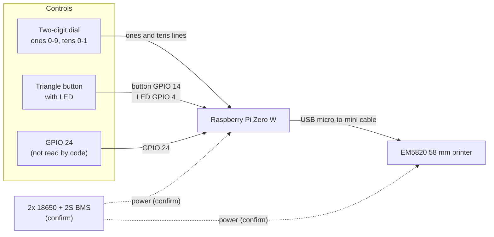

# Hardware

Parts, wiring, and pinout for version 1.0. This build is specific to these parts. Anything marked **(confirm)** is my inference and needs checking against the real build.

<!-- PHOTO: save the photo as docs/images/machine-inside.jpg, then uncomment the line below.

-->

## Parts

| Component | Vendor | Price |
| --- | --- | --- |
| 58 mm thermal receipt printer (EM5820) | Amazon | $30.00 |
| Raspberry Pi Zero W v1.1 | Adafruit | $15.00 |
| Panasonic NCR18650GA 10A 3500 mAh 18650 battery (x2) | Liion Wholesale | $8.88 |
| Power switch | Adafruit | $0.95 |
| USB-C boost charger | Amazon | $4.00 |
| 2S BMS | Amazon | $3.50 |
| Boost converter MT3608 | Amazon | $2.00 |
| Buck converter LM2596 | Amazon | $1.20 |
| Decade counter | Adafruit | $1.50 |
| Triangle button with LED | Adafruit | $3.95 |
| USB micro to mini cable | Amazon | $3.00 |
| **Total** | | **$77.58 (see note)** |

> **Note:** the line items don't add up to $77.58. They total $73.98 if $8.88 is the price for both batteries, or $82.86 if it's the price for each battery. Please check the total against your receipts.

## Wiring

The button and dial are read as active-low. The button and the dial's lines use the Pi's internal pull-ups, so a closed switch pulls its pin to ground.

### Power (confirm)

The repo doesn't document the power path, so this is my best guess from the parts list. It's a 2S battery pack with a BMS, a boost converter (MT3608) and a buck converter (LM2596), a USB-C boost module, and a power switch. I don't yet know which converter feeds the Pi and which feeds the printer, or where the power switch sits in the chain.

## Pinout

These are the pins the code uses (BCM numbering). The physical pin is the header position.

| Function | BCM | Pin | Notes |
| --- | --- | --- | --- |
| Button | GPIO 14 | 8 | Active low. Ground on pin 6. |
| Button LED | GPIO 4 | 7 | Driven high when ready, blinks while busy. Ground on pin 9. |
| Spare switch | GPIO 24 | 18 | Set up as an input, but the code never reads it. Ground on pin 20. |
| Ones 0 | GPIO 25 | 22 | Active low when selected |
| Ones 1 | GPIO 8 | 24 | |
| Ones 2 | GPIO 7 | 26 | |
| Ones 3 | GPIO 12 | 32 | |
| Ones 4 | GPIO 16 | 36 | |
| Ones 5 | GPIO 20 | 38 | |
| Ones 6 | GPIO 21 | 40 | |
| Ones 7 | GPIO 5 | 29 | |
| Ones 8 | GPIO 6 | 31 | |
| Ones 9 | GPIO 13 | 33 | |
| Tens 0 | GPIO 19 | 35 | |
| Tens 1 | GPIO 26 | 37 | |
| Ones common (confirm) | Ground | 34 | |
| Tens common (confirm) | Ground | 39 | |

**Pinout mismatch:** the old pinout table labeled GPIO 5, 6, and 13 as X6, X7, and X8, and it had no X9. The code reads them as X7, X8, and X9, and this table follows the code. If the hardware matches the old table, the dial readings will be wrong, so please confirm this on the device.

Unused GPIOs: 2 and 3 (I2C), 9 to 11 (SPI), 15 (UART RX), 17, 18, 22, 23, and 27. GPIO 14 and 15 are the UART, so the serial console has to stay off.

## Printer

The EM5820 connects to the Pi's USB data port (the micro port) with a micro-to-mini cable. The code finds it by USB ID `28e9:0289`. How the printer gets its power is **(confirm)**.
