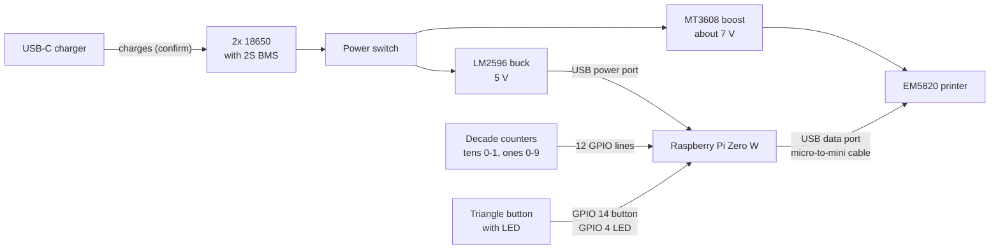

# Hardware

Parts, wiring, and pinout for version 1.0. This build is specific to these parts. Anything marked **(confirm)** is my inference and still needs checking.

<!-- PHOTO: save the photo as docs/images/machine-inside.jpg, then uncomment the line below.

-->

## Parts

| Component | Vendor | Price |
| --- | --- | --- |
| [58 mm thermal receipt printer (EM5820)](https://www.amazon.com/dp/B0FCXQPB4V) | Amazon | $30.00 |
| [Raspberry Pi Zero W v1.1](https://www.adafruit.com/product/3400) | Adafruit | $15.00 |
| [Panasonic NCR18650GA 10A 3500 mAh 18650 battery](https://liionwholesale.com/products/panasonic-sanyo-ncr18650ga-flat-top-1?variant=12534245700) (x2) | Liion Wholesale | $8.88 |
| [Power switch](https://www.adafruit.com/product/3221) | Adafruit | $0.95 |
| [USB-C boost charger](https://www.amazon.com/dp/B0BRSDS6CS) | Amazon | $4.00 |
| [2S BMS](https://www.amazon.com/dp/B087M1KJLQ) | Amazon | $3.50 |
| [Boost converter MT3608](https://www.amazon.com/dp/B0HBBPLDN7) | Amazon | $2.00 |
| [Buck converter LM2596](https://www.amazon.com/dp/B07VVXF7YX) | Amazon | $1.20 |
| [Mechanical decade counter](https://www.adafruit.com/product/1082) | Adafruit | $1.50 |
| [Triangle button with LED](https://www.adafruit.com/product/4186) | Adafruit | $3.95 |
| [USB micro to mini cable](https://www.amazon.com/dp/B0DJVG778V) | Amazon | $3.00 |
| **Total** | | **$73.98** |

The battery price is for both cells. The decade counters come in a pack of five for $7.50, and the listed price is one fifth of that. The dial uses two of them, tens and ones. **(confirm)**

## Wiring

- **Power:** The 2S pack feeds two converters. The boost converter supplies about 7 V to the printer, and the buck converter supplies 5 V to the Pi through its USB power port. Where the switch and the USB-C charger sit in that chain is **(confirm)**.
- **Printer:** It connects to the Pi's USB data port with a micro-to-mini cable, for data only. The code finds it by USB ID `28e9:0289`.
- **Dial:** Two [mechanical decade counters](https://www.adafruit.com/product/1082). Each has a common contact and ten digit contacts, and only one digit contact touches the common at a time. The commons go to ground, and each digit goes to a GPIO with the Pi's internal pull-up, so the selected digit reads low. Only the tens counter's 0 and 1 positions are wired.
- **Button:** Active low, with an internal pull-up. The LED is lit while the machine is ready, and it blinks while it's busy.
- **Headless:** There's no display, keyboard, or other USB device. Flipping the power switch boots the Pi, and a systemd service starts the program. See [SETUP.md](SETUP.md#start-at-boot).

## Pinout

BCM numbering. CMC X0 to X9 are the ones digits, and CMC 0X and 1X are the tens.

The same pinout as a text table

| Usage | Note | BCM | Pin | Pin | BCM | Note | Usage |
| --- | --- | --- | --- | --- | --- | --- | --- |
| | Power | 3V3 | 1 | 2 | 5V | Power | |
| | SDA I2C | GPIO 2 | 3 | 4 | 5V | Power | |
| | SCL I2C | GPIO 3 | 5 | 6 | Ground | | Button Ground |
| LED | | GPIO 4 | 7 | 8 | GPIO 14 | UART0_TXD | Button |
| LED Ground | | Ground | 9 | 10 | GPIO 15 | UART0_RXD | |
| | | GPIO 17 | 11 | 12 | GPIO 18 | PCM_CLK | |
| | | GPIO 27 | 13 | 14 | Ground | | |
| | | GPIO 22 | 15 | 16 | GPIO 23 | | |
| | Power | 3V3 | 17 | 18 | GPIO 24 | | |
| | MOSI | GPIO 10 | 19 | 20 | Ground | | |
| | MISO | GPIO 9 | 21 | 22 | GPIO 25 | | CMC X0 |
| | SCLK | GPIO 11 | 23 | 24 | GPIO 8 | CE0_N | CMC X1 |
| | | Ground | 25 | 26 | GPIO 7 | CE1_N | CMC X2 |
| | I2C ID EEPROM | ID_SD | 27 | 28 | ID_SC | I2C ID EEPROM | |
| CMC X7 | | GPIO 5 | 29 | 30 | Ground | | |
| CMC X8 | | GPIO 6 | 31 | 32 | GPIO 12 | | CMC X3 |
| CMC X9 | | GPIO 13 | 33 | 34 | Ground | | CMC Ones Ground |
| CMC 0X | | GPIO 19 | 35 | 36 | GPIO 16 | | CMC X4 |
| CMC 1X | | GPIO 26 | 37 | 38 | GPIO 20 | | CMC X5 |
| CMC Tens Ground | | Ground | 39 | 40 | GPIO 21 | | CMC X6 |

The image is drawn by [tools/pinout_svg.py](../tools/pinout_svg.py). If the wiring changes, update `PINS` in that script and this table together, then run `python3 tools/pinout_svg.py`.

GPIO 14 and 15 are the UART, so the serial console has to stay off.
